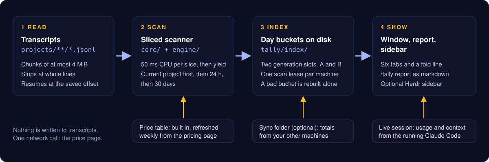

<div align="center">


# tally

**A Claude Code plugin that shows what your sessions cost in API-equivalent dollars, what the context is made of, and where you can spend less, on Windows, macOS and Linux with no dependencies.**

[Quick start](#quick-start) · [What you see](#what-you-see) · [Settings](#settings) · [Privacy](#privacy) · [Docs](./docs/README.md) · English | [简体中文](./README.zh-cn.md)

[](#license)
[](https://github.com/w21180239/tally/actions/workflows/test.yml)
[](https://github.com/w21180239/tally/stargazers)
[](#requirements)

</div>

tally reads the transcripts Claude Code already keeps on your disk and turns them into a window inside Claude Code: what this session cost, what the last 24 hours and 30 days cost, which models, repositories and subagents drove it, what sits in the context on every request, and a list of hints that each name the saving and show the evidence. Prices follow the official pricing page, and totals from several machines can be merged.

## Why

Some of what a Claude Code session spends goes where you cannot see it. A large `CLAUDE.md`, a long skill list or an unused MCP server is re-read on every request. A cache that expires during a pause is rebuilt at a higher price. A subagent on the largest model may only be reading files. The numbers are in your transcripts, but nobody reads 8 GB of JSONL by hand.

tally does the reading. It is built for people who use Claude Code every day and want to see where the money goes without leaving the session, installing a runtime or sending a transcript anywhere.

tally lives in Claude Code's plugin engine, so there is no Node, Bun, Python or binary to install. One code base serves Windows, macOS and Linux, and CI runs the test suite on all three.

A built-in price table covers every Claude model, including cache write for 5 minutes and 1 hour, fast mode and the long-context tier. It refreshes weekly from the official pricing page.

To get one total across several machines, point `syncDir` at a folder you already sync (a private git repository, OneDrive, iCloud, Syncthing). Each machine shares only its totals.

tally never writes to a transcript. Its one network call fetches the price page, and you can turn that off.

## How it works

<p align="center"></p>

1. When a session starts, a background scan reads transcripts in chunks of at most 4 MiB, stopping at whole lines. It handles the current project first, then the last 24 hours, then 30 days, and the window shows progress while the numbers grow.
2. The scan runs in slices of about 50 ms of CPU with a yield between slices, so typing and prompts are never held up.
3. Results are saved as an index of day buckets under `<config>/tally/index/`. A later start reads just the files that changed.
4. If several Claude Code sessions run on one machine, one of them holds a lease and scans; the others read the index.
5. The window, the `/tally report` command and the optional Herdr sidebar all read from that index and from the live session.

The design is written up in [docs/en/DESIGN.md](./docs/en/DESIGN.md).

## Requirements

- Claude Code 2.1.326 or later. Developed on 2.1.332.
- Windows, macOS or Linux. `git` on your PATH only if you use git-based sync from the CLI.

## Quick start

Inside Claude Code:

```text
/plugin marketplace add w21180239/tally
/plugin install tally@tally
```

Or from a shell (macOS, Linux, or PowerShell on Windows):

```bash
claude plugin marketplace add w21180239/tally
claude plugin install tally@tally
```

From a local clone (macOS, Linux, or PowerShell on Windows):

```bash
git clone https://github.com/w21180239/tally.git
claude plugin marketplace add <path-to-clone>
claude plugin install tally@tally
```

Restart Claude Code or run `/reload-plugins`, then run:

```text
/tally
```

On Windows, install Claude Code first if you have not: `irm https://claude.ai/install.ps1 | iex` in PowerShell. The `claude plugin` commands above are the same on every platform.

Update with `claude plugin update tally` (restart to apply). Remove with:

```bash
claude plugin uninstall tally@tally
claude plugin marketplace remove tally
```

The first scan of a large history takes a minute or two (see [Performance](#performance)). You can use the window while it runs.

## What you see

`/tally` opens a window with six tabs. The keys `1` to `5` and `0` switch tabs; `Esc` folds the window to a single line over the prompt, and `ctrl+x` then `tab` hands it the keyboard.

| Tab | Key | What it shows |
| --- | --- | --- |
| Session | `1` | Total cost of this session (including the launches before a resume), cost per active hour, what compaction saved (a lower bound), a bar per model, the four token kinds, cache time left and rebuild cost for each conversation, where the money went (main, each subagent, other requests), cost by skill and MCP server, and the best hint |
| Tokens | `2` | Why it cost this much, over the session, 24 hours or 30 days, for all agents or one: input by source, output (thinking, replies, writes, commands, agent prompts), cache read by content, cache write by agent and model with the biggest single write and why it happened, then the context fill by tool and the cost of each MCP server |
| Context | `3` | What each request carries: system, tools, messages, skills, MCP tools, agents, memory files, with unused and deferred items marked; subagent detail; a transcript view of any agent |
| Spend | `4` | When and where the money went, over the same session, 24 hours or 30 days: total, by day (by hour under a day), by model, main versus subagent, subagent type by model, by repository, top sessions with the `claude --resume` command |
| Hints | `5` | Hints for this session and for the past 24 hours or 30 days: title, amount, summary, action and evidence |
| Help | `0` | Data sources, color legend, keys, settings, version, price source and date, unpriced models |

The foot of the window shows cache timers with the rewrite cost, a context bar with the compact threshold, and your 5-hour and 7-day limits with reset times. Each session gets one toast when a limit goes above 80%.

### Layouts

The window picks a drawing from its width: under 40 columns a compact card, 40 to 69 narrow, 70 and up full. An inline frame under 6 rows draws a short view; any larger one, in fullscreen too, draws the tabs, never wider than 96 columns, with the chosen tab bold and underlined. The key line puts this tab's keys first, then `1-5,0 tab` and `esc fold`, and drops keys by priority as the width falls (`esc` first, the tab switch last). Folded, the window leaves one line over the prompt, most important first: `session $1.16 · ctx 21% · cache expired · ▲ 1 installed plugin never used, save ~$0.03`. Every amount carries its word (`session`, `save`), and the line gives way from the right as the terminal narrows: the entry words, the 8-hour chart (`8h`), the hint's saving, the cache, the hint down to its marker, then the context; the session cost stays. The desktop app adds a low-key summary strip (its `details ▸` button opens the window), and in VS Code the window draws without the key bar. A docked window asks for 90 by 40. Claude Code opens a window nobody asked for (the one at session start) only from 144 columns, so a narrower terminal starts folded; once you have opened the window yourself, 110 columns is enough, and under 110 columns it cannot dock. The tab bar stays on one row at any width, shortening the tab names as the dock narrows, and the Hints tab shows how many hints the session has. A docked tab taller than the dock scrolls under a fixed tab bar and foot, and a line above the key line says how many rows lie above and below. With the agent list open, the first `esc` closes the list and the next one folds the window. Fold the window with `esc` (or `/tally close`); tally remembers that and starts folded next time until you open it again with `/tally` or a click on the line. Claude Code reports clicks only in fullscreen (`/tui fullscreen`). On the main screen the folded line ends with `ctrl+x tab, enter or /tally: open` until you have opened the window from it once: `ctrl+x` then `tab` hands the line the keyboard, `enter` opens the window, and `/tally` opens it from anywhere.

### Keys

| Key | What it does |
| --- | --- |
| `1`-`5`, `0` | Switch tab (`0` is Help). |
| `tab`, `enter` | Move to and open rows. |
| `PgUp`, `PgDn`, arrows | Scroll a docked tab that is taller than the window; the mouse wheel does too. |
| `esc` | Folds the window. |
| `ctrl+x` then `tab` | Hands the folded line or the window the keyboard, on the main screen. |
| `s` | Time span: session, 24 hours, 30 days. Tokens, Spend and Hints share it (Hints has no session span). |
| `r` | Repository filter (Spend, Hints). |
| `t` | This computer or all computers (Spend, Hints, with `syncDir`; the 30-day span only on Spend). |
| `a`, `p`, `n` | Choose an agent, previous, next (Tokens, Context). |
| `v`, `b` | Full text or transcript, back (Tokens, Context). |
| `m` | Expand a truncated list. |
| `y` | Adopt the hint (Hints). |

### Words

| Word | Meaning |
| --- | --- |
| `expired` | The prompt cache has run out. The next request writes it again at the `rewrite cost`. |
| `rewrite cost` | What writing the whole context to the cache again costs on the main model. |
| `this session` | The Claude Code session you are in, including the launches before a resume. |
| `save ~$0.03` | The saving a hint estimates; `~` marks an estimate. |
| `fold`, `folded` | Shrink the window to its one line, and that state. |
| `sub-agent` | A task run by another agent that the main conversation started. |
| `computer` | One machine whose totals are merged through `syncDir`. |
| `▂▃▅▇█` | One hour's token total in the past 8 hours, oldest first; `·` is an hour with no request. |
| `⧗` | A cache timer. |

### Hints

Every hint states a saving and links to its evidence. A hint with a dollar figure appears only when it is worth at least $1 and 0.05% of the window's spend. On a subscription the dollar figures are API-list equivalents. The rules:

- `near-limit`, `limit-pace`: you are close to a 5-hour or 7-day limit, or the current pace will use it up before it resets. When both apply, one hint shows: the pace projection, with the window facts in its evidence.
- `cache-rebuilt`, `cache-ttl-choice`: caches that expired during pauses and were rewritten (the fix is compacting or clearing before you step away), and whether the 5-minute or the 1-hour cache is cheaper for your pauses (it names `promptCacheTtl`). `cache-rebuilt` suggests the setting only when most rebuilds came after a pause of 5 to 60 minutes on the 5-minute cache; pauses of hours outlast any cache.
- `mid-session-switch`: a change of model, speed (fast mode) or effort in the middle of a session that made the next request write the whole prompt into the cache again.
- `subagent-model`, `subagent-overhead`, `main-model-overkill`: work on a larger model than the task needs (the built-in Explore agent follows the main model, so the action names an Explore override), sub-agent runs of two requests or fewer that took in little tool output, and long read-only stretches on the main model (at least 50 tool turns). A low-confidence suggestion says "try it" and never "downgrade".
- `memory-heavy`, `skill-catalog-heavy`, `mcp-schema-heavy`, `unused-plugin`, `unused-mcp-server`: standing context you pay for on every request. `mcp-schema-heavy` skips tools a plugin registers itself (they cannot be deferred apart from the plugin) and needs a called server to cost $25 per 30 days to carry. `unused-plugin` names the repo where a plugin was used and suggests `claude plugin install <plugin> -s project` there.
- `long-session`, `ineffective-compaction`: sessions that grow past 70% of the window (the fix is compacting earlier, at a task boundary), and compactions that left 60% or more of the context above the session's fixed opening part (system prompt, tools, memory, listings), were followed by another within three requests, or began after the cache had expired. Only compactions with 20k+ tokens above that fixed part are judged. Compaction that sheds context is a saving; the report's Summary shows its estimated size.
- `costly-attribution`: one skill or plugin accounts for over 20% of attributed cost. A skill's figure is the cost of the requests it was active in; a plugin's figure is its own listings plus the requests of its own skills and agents, not every request it was loaded in.
- `whole-reads`, `command-output`, `tool-output`, `huge-tool-result`, `big-paste`: the same file read in full three times between compactions and edits of it (images and PDFs are skipped), commands and tools whose output is re-read on every request, a single giant tool result, a large paste.
- `thinking-output`, `effort-max`, `fast-mode`: thinking above 60% of output at `xhigh` or `max` effort (at `high` only above 70% and $3), most requests at `max` effort, and fast mode above 20% of cost.
- `long-prompt-tier`: prompts past a model's long-context price step (Haiku above 100k tokens), with the extra it billed.
- `idle-loop`: self-paced `/loop` ticks that did little yet sent the whole conversation again.

On the Hints tab, `y` adopts a hint. tally records the rule's metric, the expected saving and the date. After `recheckDays` it reminds you and shows expected against actual saving, for the rules that have a before-and-after metric.

### Multiple machines

With `syncDir` set, each machine writes its totals to `<syncDir>/tally/<machineName>.json` and reads the others. Spend and Hints then get a `t` key that switches between this computer and all computers. Blocks that cannot be merged say "This computer only" in the all-computers view. See [Privacy](#privacy) for what each `shareDetail` level shares.

### Report and Herdr

`/tally report [days] [repo]` writes a markdown spend report to `api-spend-<date>.md` in the folder Claude Code is working in, which you can read or hand to someone. A report from the same day overwrites the earlier file, and it lists repository names. Claude can call the same report through the `tally_report` tool, and the bundled `spend-optimize` skill walks through it, applies the changes you choose, and stores a baseline for a comparison 14 days on. With `herdrSidebar` on, tally also writes a sidebar for the Herdr app from report snapshots (24 hours and 30 days). Turning it off removes what tally wrote.

## Settings

Set the options through the plugin settings (`userConfig` in `plugin.json`), for example `claude plugin configure tally`. The display settings can also be changed from the prompt in any word order, for example `/tally money dollars`.

| Option | Default | Meaning |
| --- | --- | --- |
| `priceUpdate` | true | Refresh the price table weekly from the Anthropic pricing page. Off keeps the built-in prices and makes no network call. |
| `syncDir` | empty | A folder synced by something you already use. Empty turns sharing off. If it is a git repository, tally pulls and pushes it from the CLI. |
| `machineName` | hostname | How this machine is labelled in shared totals. Set it when you use `syncDir`: it is the file name each machine writes, so a name that changes (a renamed host) would count the same machine twice. |
| `shareDetail` | numbers | `numbers`, `repos` or `full`. See [Privacy](#privacy). |
| `redactEvidence` | false | Redact the evidence in the window the way the report does: commands keep only the program name, titles are blank, paths keep only the file name. |
| `recheckDays` | 14 | Days after you adopt a hint before tally checks whether the saving held. |
| `open` | before-first-message | `before-first-message` opens at session start and folds on your first message; `always` keeps it open; `never` opens it only on `/tally`. |
| `money` | cents-and-dollars | `cents-and-dollars` shows cents under $1 and dollars above; `cents` and `dollars` use one unit throughout. |
| `decimals` | auto | `auto` trims trailing zeros; `0` to `4` fixes the decimals on every amount. |
| `desktopRow` | true | A one-line summary strip over the prompt in the desktop app. |
| `herdrSidebar` | false | Also write the spend report to a Herdr sidebar. |

## Commands

| Command | What it does |
| --- | --- |
| `/tally` | Opens the window, or unfolds it. |
| `/tally close` | `close`: folds the window (same as `esc`). |
| `/tally <tab>` | Opens on `session`, `tokens`, `context`, `spend`, `hints` or `help` (`usage` and `history` still work). |
| `/tally 24h` or `30d` | Opens with that time span. |
| `/tally money dollars` | Sets a display option; also `decimals`, `open`, `row`. Word order is free. `money` also takes `both`, `dollar` and `cent`, and `row` takes `show` and `hide`. `settings` opens Help. A setting with a missing or wrong value answers with the values it accepts. |
| `/tally report [days] [repo]` | Writes a markdown spend report to `api-spend-<date>.md` in the working folder. A repository with no requests in the window writes nothing and names the repositories that have data. |
| `/tally sync` | Runs one sync now (needs `syncDir`) and lists the machines it saw. |
| `/tally debug` | Shows scan progress and totals; `--json` prints them as JSON. |

## Privacy

What tally reads: the Claude Code transcripts under `$CLAUDE_CONFIG_DIR/projects` or `~/.claude/projects` (on Windows `%USERPROFILE%\.claude\projects`), the Claude desktop app's local session folders if they exist, and the installed-plugin list for the unused-plugin hint.

What it writes: its own files under `<config>/tally/` (the index, a scan lease, progress and report snapshots); if you set `syncDir`, one totals file there; and, only when you run `/tally report`, `api-spend-<date>.md` in the current working folder (a report from the same day overwrites it, and it lists repository names). tally never writes or edits a transcript.

Network: one request, to `https://platform.claude.com/docs/en/about-claude/pricing.md`, at most once a week. It sends no data about you. Set `priceUpdate` to false and tally makes no request. If `syncDir` is a git repository, tally runs `git pull --rebase`, `commit` and `push` on it from the CLI; that talks to your own remote and nothing else. Failures are logged and never shown as an error.

What sharing sends, by `shareDetail`:

| Level | Shared with your other machines |
| --- | --- |
| `numbers` (default) | Hourly totals: date, model, token counts and cost, main versus subagent. Repositories appear only as irreversible aliases. |
| `repos` | Adds repository names and per-repository totals. |
| `full` | Adds session titles, top sessions, context fill by tool and each machine's hints with evidence. |

Keep any machine whose repository names or titles are private at `numbers`. Repository aliases are an HMAC with a salt stored in `<syncDir>/tally/salt`, created by the first machine, so the same repository has the same alias everywhere. Transcripts stay on the machine that made them, so nothing is counted twice.

## Windows, macOS and Linux

- One code base and one install command on all three. Paths accept both `/` and `\`. The home folder comes from `HOME`, with `USERPROFILE` as the fallback on Windows.
- CI runs `claude plugin validate` and `claude plugin test` on macOS, Windows and Ubuntu for every push.
- Git-based sync needs `git` on PATH and runs only from the CLI. The desktop app and VS Code skip it; the next CLI session pushes.
- The Herdr sidebar folder is `HERDR_APP_HOME` when set, otherwise `~/.config/herdr-app` on macOS and Linux and `%APPDATA%\herdr-app` on Windows. If the folder does not exist, tally writes nothing.

## Performance

Measured on one macOS development machine on 2026-11-27, with 30 days of history: about 8.3 GB in 82,000 transcript files.

| What | Result |
| --- | --- |
| Cold scan, from nothing to done | 84 to 89 s (target: 120 s or less) |
| Warm start, index already on disk | about 5 s, up to about 13 s under heavy machine load, with no transcript bytes read |
| Incremental update after a few files change | under 5 s |
| Index size on disk after the cold scan | 96.7 MB, about 1.2% of the transcript size |
| CPU per scan slice | about 50 ms, then yield |

The full method is in [docs/en/DESIGN.md](./docs/en/DESIGN.md). Typing latency during a scan has not been measured by hand yet.

Accuracy was checked against ccusage on that machine over the 30 local days from 2026-10-30 to 2026-11-28: tally was within 0.010% of ccusage on the total and within 0.03% on each model. The figures, method and known definitional differences are in [scripts/compare.md](./scripts/compare.md).

## Limitations

- Claude Code only. Codex, Cursor and other agents are not read.
- Dollar amounts are API-equivalent: what the same usage would cost at list prices. They are not your subscription bill.
- Batch and data-residency pricing are not covered, because transcripts carry no signal for them.
- A context breakdown is only available for the running main session. For history, tally keeps a snapshot per live session and uses the nearest one as a stand-in, marked with `*`.
- There is no per-subagent context breakdown.
- Models that are not Anthropic's are listed as unpriced. Unknown Claude models use the latest price of their family and are marked `*`.
- The first scan of a very large history takes a minute or more; the window shows partial numbers until it finishes.
- Windows is covered by CI; manual testing on a real Windows machine is pending.

## Contributing

Bug reports, wrong numbers and hints that fired at the wrong moment are the most useful things to send. See [CONTRIBUTING.md](./CONTRIBUTING.md) and [AGENTS.md](./AGENTS.md). Security reports go through [SECURITY.md](./SECURITY.md).

```bash
claude plugin validate .
claude plugin test .
```

## License

Dual-licensed under [MIT](./LICENSE-MIT) or [Apache-2.0](./LICENSE-APACHE), at your option.
