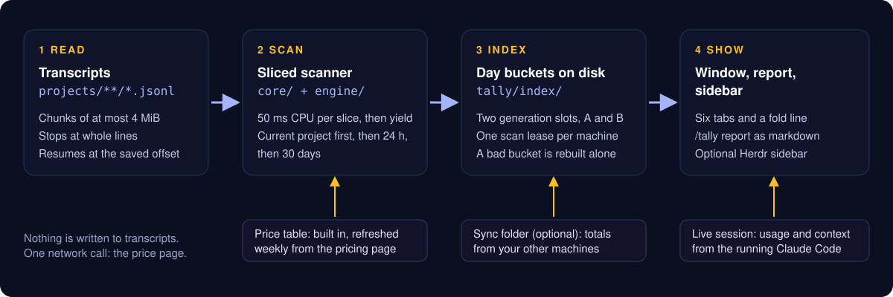

<div align="center">


# tally

**一个 Claude Code 插件：按 API 等价美元显示会话花了多少钱、context 由什么构成、哪里可以少花钱。支持 Windows、macOS 和 Linux，零依赖。**

[快速开始](#快速开始) · [能看到什么](#能看到什么) · [设置](#设置) · [隐私](#隐私) · [文档](./docs/README.md) · [English](./README.md) | 简体中文

[](#许可证)
[](https://github.com/w21180239/tally/actions/workflows/test.yml)
[](https://github.com/w21180239/tally/stargazers)
[](#环境要求)

</div>

tally 读取 Claude Code 已经保存在你磁盘上的 transcript，在 Claude Code 里开出一个窗口：这个会话花了多少、最近 24 小时和 30 天花了多少、哪些模型、仓库和子代理在花钱、每次请求的 context 里装着什么，以及一份省钱提示清单，每条都写明能省多少并附上证据。价格跟随官方定价页，多台电脑的统计可以合并。

## 为什么做它

Claude Code 会话里有些开销看不见。体积很大的 `CLAUDE.md`、很长的 skill 清单、没人用的 MCP server，每次请求都会被重新读一遍；停顿期间过期的缓存会以更高的价格重写；跑在最大模型上的子代理可能只是在读文件。这些数字都在 transcript 里，但没人会手工去读 8 GB 的 JSONL。

tally 替你读。它面向每天使用 Claude Code 的人：不离开会话、不装运行时、不把 transcript 发到任何地方，就能看到钱花在了哪里。

tally 直接跑在 Claude Code 自带的插件引擎里，不需要安装 Node、Bun、Python 或任何二进制。Windows、macOS、Linux 共用一份代码，CI 在三个平台上都跑测试。

内置价格表覆盖所有 Claude 模型，包括 5 分钟和 1 小时的缓存写入、fast 模式和 long-context 档，并每周从官方定价页刷新。

想要多台电脑合成一个总数，就把 `syncDir` 指向你已经在同步的文件夹（私有 git 仓库、OneDrive、iCloud、Syncthing 都行），每台电脑只共享自己的汇总。

不写任何 transcript。唯一的网络请求是价格页，而且可以关掉。

## 工作原理

<p align="center"></p>

1. 会话启动后，后台扫描每次最多读 4 MiB，并停在完整的行末。它先处理当前项目，再处理最近 24 小时，最后是 30 天；数字增长期间窗口会显示进度。
2. 扫描按约 50 ms CPU 的时间片执行，片与片之间让出，所以输入和提交 prompt 不会被卡住。
3. 结果保存为按天分桶的索引，位于 `<config>/tally/index/`。下次启动只读有变化的部分。
4. 同一台电脑上开了多个 Claude Code 会话时，只有一个会话持有租约并负责扫描，其余会话读取索引。
5. 窗口、`/tally report` 命令和可选的 Herdr 侧栏都读这份索引和当前会话。

设计详见 [docs/zh-cn/DESIGN.md](./docs/zh-cn/DESIGN.md)。

## 环境要求

- Claude Code 2.1.326 或更高版本，开发环境为 2.1.332。
- Windows、macOS 或 Linux。只有在 CLI 里使用基于 git 的同步时，才需要 PATH 里有 `git`。

## 快速开始

在 Claude Code 里：

```text
/plugin marketplace add w21180239/tally
/plugin install tally@tally
```

或者在 shell 里（macOS、Linux，或 Windows 的 PowerShell）：

```bash
claude plugin marketplace add w21180239/tally
claude plugin install tally@tally
```

从本地克隆安装（macOS、Linux，或 Windows 的 PowerShell）：

```bash
git clone https://github.com/w21180239/tally.git
claude plugin marketplace add <克隆目录的路径>
claude plugin install tally@tally
```

重启 Claude Code 或运行 `/reload-plugins`，然后执行：

```text
/tally
```

Windows 上如果还没装 Claude Code，先在 PowerShell 里运行 `irm https://claude.ai/install.ps1 | iex`。上面的 `claude plugin` 命令在各平台一致。

更新用 `claude plugin update tally`（重启后生效）。卸载：

```bash
claude plugin uninstall tally@tally
claude plugin marketplace remove tally
```

历史很大时，第一次扫描需要一两分钟（见[性能](#性能)），期间窗口可以正常使用。

## 能看到什么

`/tally` 打开一个有六个标签页的窗口。按 `1` 到 `5` 和 `0` 切换标签；`Esc` 把窗口折叠成 prompt 上方的一行；先按 `ctrl+x` 再按 `tab`，键盘焦点交给窗口。

| 标签 | 键 | 内容 |
| --- | --- | --- |
| Session | `1` | 本会话总花费（含 resume 之前的各次启动）、每活跃小时花费、按模型的条形图、四种 token 类型、每个对话的缓存剩余时间和重写成本、钱花在哪里（主会话、各子代理、其他请求）、按 skill 与 MCP server 的归因，以及最重要的一条提示 |
| Usage | `2` | 本会话、24 小时或 30 天，全部 agent 或某一个：输入按来源，输出（thinking、回复、写文件、命令、agent prompt），缓存读取按内容，缓存写入按 agent 和模型，并给出最大的单次写入及原因 |
| Context | `3` | 每次请求带了什么：system、工具、消息、skills、MCP 工具、agents、memory 文件，并标出未使用和 deferred 的项；子代理详情；可查看任一 agent 的 transcript |
| History | `4` | 30 天：总额、token 类型、按日、按模型、主会话与子代理、子代理类型×模型、按仓库、Top sessions（附 `claude --resume` 命令）、按工具的 context 填充 |
| Hints | `5` | 本会话以及过去 24 小时或 30 天的提示：标题、金额、摘要、建议操作和证据 |
| Help | `0` | 数据来源、颜色图例、键位、设置、版本、价格来源与更新日期、未定价的模型 |

窗口底部显示缓存计时和重写成本（rewrite cost）、带 compact 阈值的 context 条，以及 5 小时和 7 天限额与重置时间。限额超过 80% 时，每个会话弹一次 toast。

### 布局

窗口按宽度选择排版：小于 40 列为紧凑卡片，40 到 69 列为窄版，70 列及以上为完整版。内嵌显示且不足 10 行时画简短视图。窗口折叠后，prompt 上方只留一行，按重要性排序：`session $1.16 · ctx 21% · cache expired · ▲ 1 installed plugin never used, save ~$0.03`。每个金额都带语义词（`session`、`save`）；终端变窄时从右侧依次丢掉：进入方式提示、8 小时字符图（`8h`）、提示的可省金额、缓存、提示（只剩标记），最后是 context，会话花费保留。桌面应用多一条低调的摘要栏（其 `details ▸` 按钮打开窗口），VS Code 里窗口照常绘制，只是不显示键位栏。停靠窗口默认请求 90×40。Claude Code 只对“没人要求打开”的窗口（会话开始时那一次）要求终端至少 144 列，更窄时窗口默认折叠；你自己打开过一次之后，110 列就够了，小于 110 列时无法停靠。标签栏在任何宽度下都只占一行，窗口变窄时标签名依次缩短，Hints 标签会显示本会话的提示数量。停靠的标签页比窗口高时，在固定的标签栏和底栏之间滚动，键位栏上方一行会写出上方和下方还有多少行。打开 agent 列表时，第一次 `esc` 先关闭列表，再按一次才折叠窗口。用 `esc`（或 `/tally close`）折叠窗口；tally 会记住这一选择，之后每次都折叠启动，直到你用 `/tally` 或点击折叠行再次打开。Claude Code 只在全屏（`/tui fullscreen`）下上报点击。在主屏幕上，折叠行末尾会写 `ctrl+x tab, enter or /tally: open`，直到你从这一行打开过一次窗口：先按 `ctrl+x` 再按 `tab` 把键盘交给这一行，`enter` 打开窗口，`/tally` 在任何时候都能打开。

### 键位

| 键 | 作用 |
| --- | --- |
| `1`-`5`、`0` | 切换标签（`0` 是 Help）。 |
| `tab`、`enter` | 移动到行并打开。 |
| `PgUp`、`PgDn`、方向键 | 滚动比窗口高的停靠标签页；鼠标滚轮同样可用。 |
| `esc` | 折叠窗口。 |
| `ctrl+x` 然后 `tab` | 在主屏幕上把键盘交给折叠行或窗口。 |
| `s` | 时间跨度（Usage、Hints）。 |
| `r` | 仓库过滤（History、Hints）。 |
| `t` | 本机或全部电脑（History、Hints，需设置 `syncDir`）。 |
| `a`、`p`、`n` | 选择 agent、上一个、下一个（Usage、Context）。 |
| `v`、`b` | 完整文本或 transcript、返回（Usage、Context）。 |
| `m` | 展开被截断的列表。 |
| `y` | 采纳提示（Hints）。 |

### 术语

| 词 | 含义 |
| --- | --- |
| `expired` | prompt 缓存已过期；下一次请求会按 `rewrite cost` 重新写入。 |
| `rewrite cost` | 在主模型上把整个 context 重新写入缓存的成本。 |
| `this session` | 你所在的 Claude Code 会话，包括 resume 之前的各次启动。 |
| `save ~$0.03` | 提示估算的可省金额；`~` 表示估算值。 |
| `fold`、`folded` | 把窗口收成一行，以及这个状态。 |
| `sub-agent` | 由主对话启动、交给另一个 agent 运行的任务。 |
| `computer` | 通过 `syncDir` 合并汇总的一台机器。 |
| `▂▃▅▇█` | 过去 8 小时中每小时的 token 总量，最早的在前；`·` 表示该小时没有请求。 |
| `⧗` | 缓存计时。 |

### 提示（Hints）

每条提示都写明能省多少，并链接到证据。规则如下：

- `near-limit`、`limit-pace`：已接近 5 小时或 7 天限额，或按当前速度会在重置前用完。
- `cache-rebuilt`、`cache-ttl-choice`：停顿期间缓存过期后被重写；按你的停顿习惯，5 分钟缓存和 1 小时缓存哪个更省。
- `subagent-model`、`subagent-overhead`、`main-model-overkill`：任务用了比所需更大的模型、大量很小的子代理任务、主会话在大模型上长时间只读。置信度低的建议只提示“试用”，不会直接建议降级。
- `memory-heavy`、`skill-catalog-heavy`、`mcp-schema-heavy`、`unused-plugin`、`unused-mcp-server`：每次请求都在为之付费的常驻 context。
- `long-session`、`ineffective-compaction`：增长超过窗口 70% 的会话（办法是在任务边界更早地 compact），以及压缩后上下文仍保留 60% 以上、在 3 次请求内又被压缩、或在缓存已过期后才开始的 compaction。能缩小上下文的 compaction 是节省；报告的 Summary 会给出估算的节省额。
- `costly-attribution`：某个 skill 或插件占归因花费的 20% 以上。
- `whole-reads`、`command-output`、`tool-output`、`huge-tool-result`、`big-paste`：同一文件被整读三次、输出每次请求都被重读的命令和工具、单次极大的工具结果、很大的粘贴。
- `thinking-output`、`fast-mode`：thinking 超过输出的 60%，以及 fast 模式超过花费的 20%。

在 Hints 标签页按 `y` 采纳一条提示。tally 会记下该规则的度量值、预期节省和日期。过了 `recheckDays` 天后提醒你，并对有前后可比度量的规则显示“预期省多少、实际省多少”。

### 多台电脑

设置 `syncDir` 后，每台电脑把自己的汇总写到 `<syncDir>/tally/<machineName>.json`，并读入其他电脑的文件。History 和 Hints 会多一个 `t` 键，在“本机”和“所有电脑”之间切换。无法合并的区块在“所有电脑”视图里标注“仅本机”。各 `shareDetail` 级别共享什么，见[隐私](#隐私)。

### 报告与 Herdr

`/tally report [days] [repo]` 把一份 markdown 花费报告写到 Claude Code 当前工作目录下的 `api-spend-<日期>.md`，可以自己读，也可以交给别人。同一天再次生成会覆盖之前的文件，报告里会列出仓库名。Claude 可以通过 `tally_report` 工具取同一份报告；随插件提供的 `spend-optimize` skill 会带着走一遍流程、应用你选中的改动，并保存一份基线，14 天后用来对比。打开 `herdrSidebar` 后，tally 还会根据报告快照（24 小时和 30 天）为 Herdr 应用写一个侧栏；关掉它会清理 tally 写过的内容。

## 设置

通过插件设置（`plugin.json` 里的 `userConfig`）修改，例如 `claude plugin configure tally`。显示类设置也可以在 prompt 里改，词序不限，例如 `/tally money dollars`。

| 选项 | 默认值 | 含义 |
| --- | --- | --- |
| `priceUpdate` | true | 每周从 Anthropic 定价页刷新价格表。关闭则使用内置价格，并且不发任何网络请求。 |
| `syncDir` | 空 | 一个由你已有的工具同步的文件夹。留空则关闭共享。如果它是 git 仓库，tally 会在 CLI 里对它 pull 和 push。 |
| `machineName` | 主机名 | 这台电脑在共享汇总里的标签。使用 `syncDir` 时建议设置：它就是每台电脑写入的文件名，名字一变（例如主机改名），同一台电脑会被算两次。 |
| `shareDetail` | numbers | `numbers`、`repos` 或 `full`，见[隐私](#隐私)。 |
| `redactEvidence` | false | 窗口里的证据也像报告一样脱敏：命令只留程序名，标题清空，路径只留文件名。 |
| `recheckDays` | 14 | 采纳一条提示后过多少天，tally 去核对节省是否真的保持住了。 |
| `open` | before-first-message | `before-first-message` 在会话开始时打开、你发出第一条消息后折叠；`always` 一直保持打开；`never` 只在 `/tally` 时打开。 |
| `money` | cents-and-dollars | `cents-and-dollars` 在 1 美元以下显示美分、以上显示美元；`cents` 和 `dollars` 全程使用同一个单位。 |
| `decimals` | auto | `auto` 去掉末尾多余的零；`0` 到 `4` 让每个金额固定显示该位数。 |
| `desktopRow` | true | 桌面应用里 prompt 上方的一行摘要栏。 |
| `herdrSidebar` | false | 同时把花费报告写到 Herdr 侧栏。 |

## 命令

| 命令 | 作用 |
| --- | --- |
| `/tally` | 打开窗口，或展开已折叠的窗口。 |
| `/tally close` | `close`：折叠窗口（等同于 `esc`）。 |
| `/tally <tab>` | 直接打开到 `session`、`usage`、`context`、`history`、`hints` 或 `help`。 |
| `/tally 24h` 或 `30d` | 以该时间跨度打开。 |
| `/tally money dollars` | 设置显示选项；还有 `decimals`、`open`、`row`，词序不限。`money` 还接受 `both`、`dollar`、`cent`，`row` 接受 `show`、`hide`；`tokens` 打开 Usage tab，`settings` 打开 Help。设置缺值或取值不对时，回复会列出可用的值。 |
| `/tally report [days] [repo]` | 把 markdown 花费报告写到工作目录下的 `api-spend-<日期>.md`。仓库在窗口内没有请求时不写文件，并列出有数据的仓库。 |
| `/tally sync` | 立即同步一次（需要设置 `syncDir`），并列出看到的电脑。 |
| `/tally debug` | 显示扫描进度和总数；加 `--json` 以 JSON 输出。 |

## 隐私

tally 读取的内容：`$CLAUDE_CONFIG_DIR/projects` 或 `~/.claude/projects` 下的 Claude Code transcript（Windows 上是 `%USERPROFILE%\.claude\projects`）、Claude 桌面应用的本地会话目录（如果存在），以及供 unused-plugin 提示使用的已安装插件列表。

写入的内容：`<config>/tally/` 下它自己的文件（索引、扫描租约、进度和报告快照），设置了 `syncDir` 时放在那里的一个汇总文件，以及只在你运行 `/tally report` 时写到当前工作目录的 `api-spend-<日期>.md`（同一天再次生成会覆盖，报告里会列出仓库名）。tally 从不写入或修改 transcript。

网络：只有一个请求，发往 `https://platform.claude.com/docs/en/about-claude/pricing.md`，最多每周一次，不携带任何关于你的数据。把 `priceUpdate` 设为 false，tally 就不发任何请求。如果 `syncDir` 是 git 仓库，tally 会在 CLI 里对它执行 `git pull --rebase`、`commit` 和 `push`，只与你自己的远端通信。失败只记日志，不会弹错误。

按 `shareDetail` 共享的内容：

| 级别 | 与你的其他电脑共享什么 |
| --- | --- |
| `numbers`（默认） | 按小时的汇总：日期、模型、token 数和金额、主会话与子代理。仓库只以不可逆的别名出现。 |
| `repos` | 增加仓库名和按仓库的汇总。 |
| `full` | 再增加会话标题、Top sessions、按工具的 context 填充，以及各电脑的提示和证据。 |

仓库名或标题属于隐私的电脑，应保持 `numbers`。仓库别名是 HMAC，盐保存在 `<syncDir>/tally/salt`，由第一台电脑生成，所以同一个仓库在每台电脑上的别名相同。transcript 只留在产生它的那台电脑上，因此不会重复计数。

## Windows、macOS 和 Linux

- 三个平台同一份代码、同一条安装命令。路径同时接受 `/` 和 `\`。home 目录取 `HOME`，Windows 上回退到 `USERPROFILE`。
- CI 在每次 push 时于 macOS、Windows 和 Ubuntu 上运行 `claude plugin validate` 与 `claude plugin test`。
- 基于 git 的同步需要 PATH 里有 `git`，并且只在 CLI 里运行。桌面应用和 VS Code 会跳过，下一次 CLI 会话再推送。
- Herdr 侧栏目录：设置了 `HERDR_APP_HOME` 就用它，否则 macOS 和 Linux 用 `~/.config/herdr-app`，Windows 用 `%APPDATA%\herdr-app`。该目录不存在时，tally 什么也不写。

## 性能

2026-11-27 在一台 macOS 开发机上实测，30 天历史约 8.3 GB、82,000 个 transcript 文件。

| 项目 | 结果 |
| --- | --- |
| 冷读，从无到完成 | 84 至 89 秒（目标不超过 120 秒） |
| 暖启动，索引已在磁盘上 | 约 5 秒，机器负载很高时最多约 13 秒，不读任何 transcript 字节 |
| 少数文件变化后的增量更新 | 5 秒以内 |
| 冷读后索引占用磁盘 | 96.7 MB，约为 transcript 体积的 1.2% |
| 每个扫描时间片的 CPU | 约 50 ms，随后让出 |

完整方法见 [docs/zh-cn/DESIGN.md](./docs/zh-cn/DESIGN.md)。扫描期间的打字延迟还没有人工实测过。

准确性方面，在同一台电脑上对 2026-10-30 至 2026-11-28 的 30 个本地日与 ccusage 做了对数：总额相差不超过 0.010%，每个模型相差不超过 0.03%。数据、方法和已知的定义性差异见 [scripts/compare.md](./scripts/compare.md)。

## 限制

- 只支持 Claude Code，不读取 Codex、Cursor 等其他 agent。
- 金额是 API 等价金额：同样的用量按标价会花多少钱，并不是你的订阅账单。
- 不覆盖 Batch 和数据驻留定价，因为 transcript 里没有这两类信号。
- context 拆分只对正在运行的主会话可用。历史数据用每个 live 会话保存的快照，取时间上最近的一份代替，并标 `*`。
- 没有按子代理的 context 拆分。
- 非 Anthropic 模型列为未定价。未知的 Claude 模型按同族最新价格计，并标 `*`。
- 历史特别大时，首次扫描要一分钟以上，完成前窗口显示的是部分数字。
- Windows 由 CI 覆盖；尚未在真实的 Windows 电脑上做手工测试。

## 参与贡献

最有用的是 bug 报告、数字不对的情况，以及在不合适的时机弹出的提示。见 [CONTRIBUTING.md](./CONTRIBUTING.md) 和 [AGENTS.md](./AGENTS.md)。安全问题请按 [SECURITY.md](./SECURITY.md) 报告。

```bash
claude plugin validate .
claude plugin test .
```

## 许可证

采用 [MIT](./LICENSE-MIT) 或 [Apache-2.0](./LICENSE-APACHE) 双许可，任选其一。
